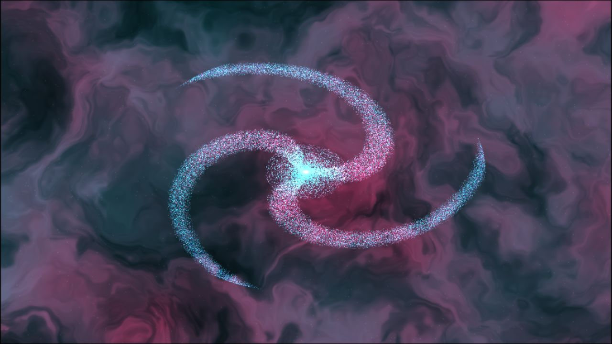
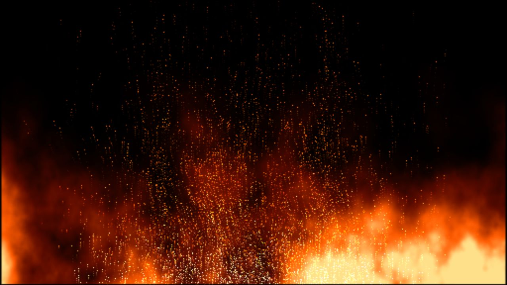
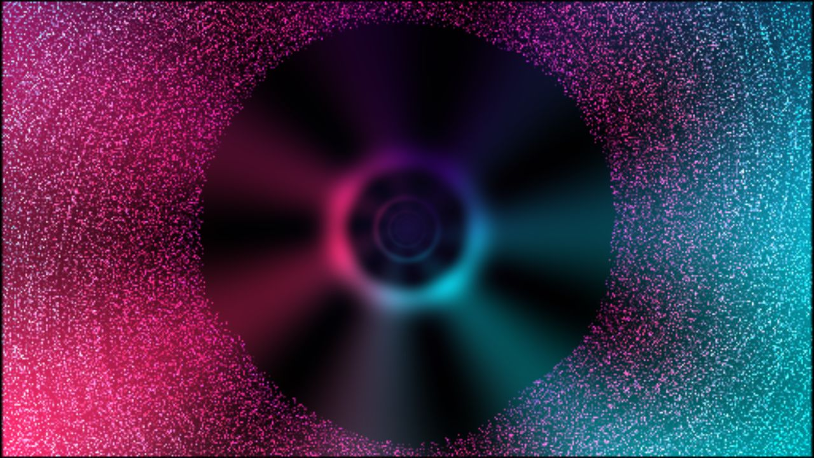
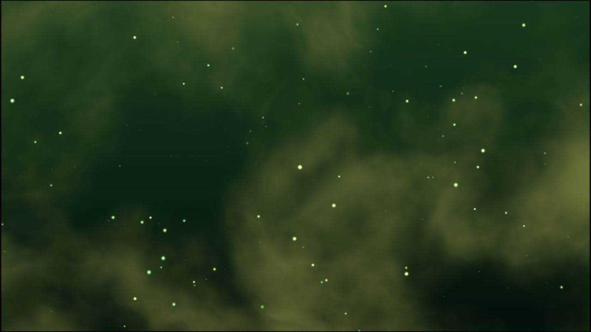
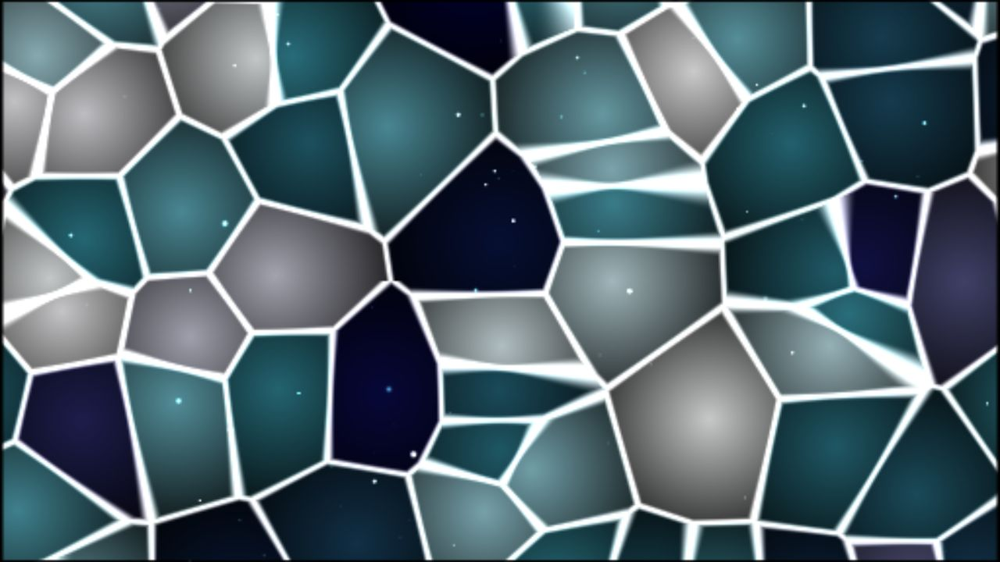
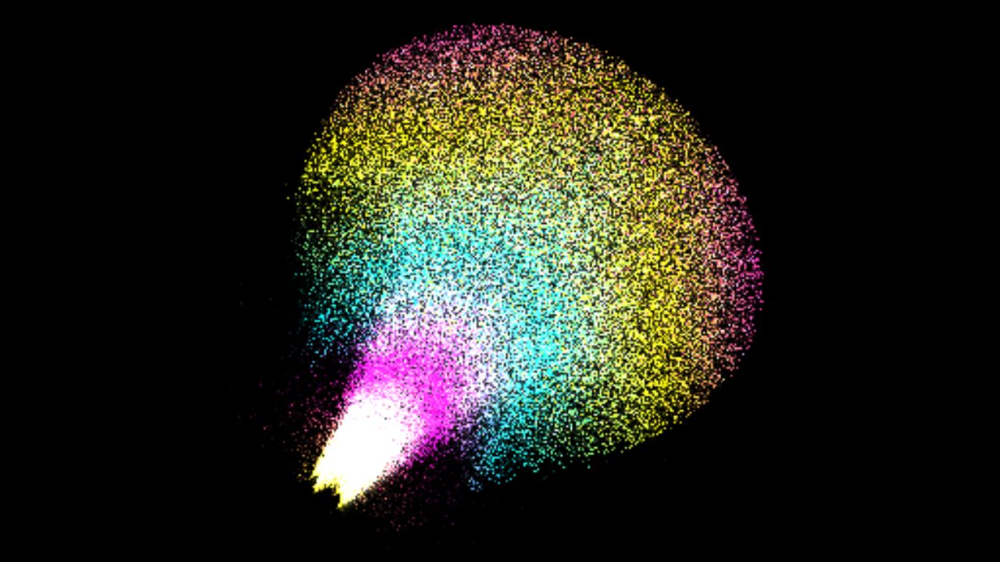

<p align="center">
  
</p>

<h1 align="center">Life Projector</h1>

<p align="center">
  <b>Projection mapping y ambientes con proyectores, open source.</b><br>
  <i>Open source projection mapping & ambient visuals for projectors, TVs and Google TV.</i>
</p>

<p align="center">
    <br>
    
</p>

> 🇪🇸 Español abajo · 🇬🇧 [English below](#-english)

---

## 🇪🇸 Español

Life Projector es una app web que convierte cualquier proyector, TV o Google TV en una pantalla de **efectos de luz, partículas y ambientes**, con **mapping de superficies**, **zonas de protección** y **corrección óptica**. Todo corre en tu red local: levantas el servidor con Docker, abres la pantalla en el proyector y controlas todo desde el celular.

Es nuestro aporte a la comunidad que usa proyectores para crear ambientes. Clónalo, úsalo, modifícalo y comparte. ❤️

### ✨ Qué incluye

| | |
|---|---|
| 🎨 **20 efectos GPU** | Aurora, nebulosa, fuego, agua/cáusticas, nubes, líquido, plasma, túnel, caleidoscopio, mandala, hiperespacio, cristales, panal, ondas de luz, lámpara de lava, lluvia digital, degradado, color sólido, patrones de prueba… |
| ✨ **10 sistemas de partículas** | Simulados 100 % en GPU (WebGL2 transform feedback), hasta **250 000 partículas** con estelas: campo de flujo, galaxia, luciérnagas, nieve, brasas, lluvia, atractor extraño, vórtice, fuente, bokeh. Se combinan con cualquier efecto. |
| 🧱 **Mapping de superficies** | Varias superficies por pantalla, cada una con su efecto. Arrastra 4 esquinas (corner-pin con homografía real) para calzar con cuadros, columnas, muebles o fachadas. Opacidad, borde suave, mezcla aditiva. |
| ⛔ **Zonas de protección** | Polígonos que **bloquean la luz** (ojos, ventanas, TVs, cuadros) o que limitan la proyección a una forma. Con borde difuminado. |
| 🔭 **Óptica del proyector** | Keystone de 4 esquinas, espejo (retroproyección), invertir (montaje en techo), brillo, contraste, gamma, saturación, temperatura de color, viñeta, **fusión de bordes** para varios proyectores, patrones de prueba (grilla / blanco). |
| 🎵 **Audio reactivo** | Pulso automático por BPM (con *tap tempo*), micrófono del celular transmitido a la pantalla, o micrófono de la propia pantalla. |
| 🌙 **Ambientes listos** | 14 escenas: Noche de aurora, Galaxia, Bosque encantado, Fondo del mar, Fogata, Nevada, Tormenta, Fiesta neón, Zen, Lámpara de lava, Caos hipnótico, Seda fluida, Cueva de cristal, Mandala. Guarda las tuyas. |
| ⟳ **Programación** | Rota escenas automáticamente cada N minutos. Lo hace el servidor, así que funciona aunque cierres el celular. |
| ✍️ **Crea tus efectos** | Pestaña **Crear**: editor GLSL en vivo con plantillas, errores marcados por línea y vista previa al instante. Guarda en tu biblioteca y comparte como archivo `.lpfx.json`. |
| 🖼 **Fotos con marco y estilo** | Sube fotos y videos y mapéalos sobre cualquier superficie. Marcos de **madera**, **dorado clásico**, **galería** con paspartú, **bastidor/lienzo** y **Polaroid**. Estilos **óleo**, **acuarela**, **lápiz** y **puntillismo**, y una animación en la que la foto **se pinta sola**. Respeta la orientación de las fotos del celular. |
| 🎞 **Galería de fotos** | Pase de fotos con fundido, pinceladas o corte, zoom lento (Ken Burns) y orden aleatorio, dentro del mismo marco y estilo. **Todas las pantallas muestran la misma foto al mismo tiempo.** |
| 📡 **Multi-pantalla** | Controla varios proyectores a la vez; cada uno guarda su propia calibración. Aplica una escena a todos con un toque. |
| 📱 **Control desde el celular** | Interfaz responsive (PWA instalable), en español e inglés. Las guías de calibración se ven en la pared mientras arrastras en el celular. |
| 📺 **App Android / Google TV** | Descubre el servidor automáticamente (mDNS), pantalla completa, arranque automático al encender. |

### 🚀 Inicio rápido (Docker)

```bash
git clone https://github.com/nachol/life-projector.git
cd life-projector
docker compose up -d
```

1. **Proyector / TV**: abre `http://IP-DE-TU-PC:8080/display` en su navegador (o usa la app de Android TV). Pulsa **F** para pantalla completa.
2. **Celular**: abre `http://IP-DE-TU-PC:8080` (o escanea el QR que aparece en la pantalla).
3. Elige un ambiente en **Escenas**. Luego ajusta **Superficies**, **Zonas** y **Óptica** arrastrando en la vista previa.

> 💡 Para usar el micrófono o la API de segunda pantalla, abre `https://IP-DE-TU-PC:8443` (certificado autofirmado: acepta la advertencia una vez).

**Linux con descubrimiento automático (mDNS) para la app de TV:**

```bash
docker compose -f docker-compose.yml -f docker-compose.host.yml up -d
```

**Sin Docker** (Node 20+):

```bash
npm install
npm start
```

### 📡 Formas de “castear” a un proyector

| Método | Cómo |
|---|---|
| **Navegador en el proyector / TV / PC** | Abre `/display`. Aparece sola en la lista de pantallas del celular. |
| **App Android TV / Google TV** | Instala el APK ([Releases](../../releases) o artefacto de GitHub Actions). Encuentra el servidor por mDNS o escribe la IP. |
| **Chromecast / Google TV con Cast** | Desde Chrome en la PC: botón **Transmitir (Cast)** en el diálogo de pantallas (Presentation API). |
| **Proyector conectado por HDMI a tu PC** | Botón **Segunda pantalla**: abre la pantalla directo en el otro monitor (Window Management API en Chrome). |
| **Celular o tablet como pantalla** | Abre `/display` en el dispositivo. |

### 🎯 Flujo de calibración recomendado

1. **Óptica → Patrón de prueba: Grilla.** Arrastra las 4 esquinas amarillas (keystone) hasta que la grilla quede recta en la pared. Activa *espejo* o *invertir* según el montaje.
2. **Superficies.** Añade una por cada objeto (cuadro, columna, ventana). Arrastra sus esquinas. Activa **Mostrar guías en la pantalla** para ver los contornos en la pared mientras ajustas. Usa las flechas para ajuste fino al píxel (Shift = 10 px).
3. **Zonas.** Dibuja zonas protegidas donde no debe llegar luz (por ejemplo, la altura de los ojos de quien está sentado en un sofá, o una TV).
4. **Escenas.** Elige un ambiente: se aplica **sin perder tu calibración**. Guarda tus combinaciones favoritas.

### ⚙️ Configuración (variables de entorno)

| Variable | Por defecto | Descripción |
|---|---|---|
| `PORT` | `8080` | Puerto HTTP |
| `HTTPS_PORT` | `8443` | Puerto HTTPS con certificado autofirmado (`0` lo desactiva) |
| `DATA_DIR` | `./data` (`/data` en Docker) | Escenas, calibraciones, medios y certificado |
| `ACCESS_TOKEN` | — | Si se define, controladores y pantallas necesitan el token (`?token=...` una vez) |
| `MAX_UPLOAD_MB` | `1024` | Tamaño máximo de subida |
| `MDNS` | `true` | Anunciar `_lifeprojector._tcp` en la red |
| `SERVER_NAME` | `Life Projector` | Nombre visible |
| `TLS_KEY` / `TLS_CERT` | — | Rutas a tu propio certificado |

> 🔐 **Seguridad**: está pensado para redes locales de confianza. Sin `ACCESS_TOKEN`, cualquiera en tu red puede controlar las pantallas. No lo expongas a Internet sin un proxy con autenticación.

### 🧩 Arquitectura

```
 Celular / PC (controlador)          Servidor Node (Docker)                Proyector / TV (display)
 ┌──────────────────────┐   WS    ┌──────────────────────────┐   WS    ┌──────────────────────────┐
 │ UI + vista previa GL │ ◀─────▶ │ hub en tiempo real       │ ◀─────▶ │ motor WebGL2             │
 │ arrastre de esquinas │  REST   │ escenas / medios / estado│         │ efectos → mapping →      │
 │ micrófono (opcional) │ ──────▶ │ programación, mDNS, HTTPS│         │ keystone → zonas → color │
 └──────────────────────┘         └──────────────────────────┘         └──────────────────────────┘
```

La pantalla renderiza todo localmente en su GPU; por la red solo viaja el estado (JSON pequeño), así que funciona fluido incluso en Wi-Fi modesto. Detalles en [docs/ARCHITECTURE.md](docs/ARCHITECTURE.md).

### 🤝 Contribuir

¡Nuevos efectos, sistemas de partículas, traducciones y mejoras son bienvenidos! Puedes crear efectos desde la pestaña **Crear** sin tocar el código, y compartir el `.lpfx.json`; o sumarlos al repo como efectos incluidos. Lee [CONTRIBUTING.md](CONTRIBUTING.md).

---

## 🇬🇧 English

Life Projector is a web app that turns any projector, TV or Google TV into a canvas for **light effects, GPU particles and ambiences**, with **surface mapping**, **protection zones** and **projector optics correction**. Everything runs on your local network: start the server with Docker, open the display page on the projector and control it from your phone.

### Features

- **20 GPU shader effects** and **10 GPU particle systems** (WebGL2 transform feedback, up to 250k particles with trails), combinable per surface.
- **Multi-surface corner-pin mapping** with true perspective (homography), soft edges, opacity and additive blending.
- **Protection zones**: feathered polygons that block light (eyes, windows, screens) or restrict projection to a shape.
- **Optics**: 4-corner keystone, mirror / flip (rear & ceiling mount), brightness, contrast, gamma, saturation, colour temperature, vignette, **edge blending** for multi-projector setups, test patterns.
- **Photos with frames and painterly styles**: wood, classic gold, gallery with mat, stretched canvas and Polaroid frames; oil, watercolour, pencil and pointillism styles; a "paints itself" reveal animation. Phone photos keep their EXIF orientation.
- **Photo gallery**: slideshow with crossfade, brush-stroke or cut transitions, slow Ken Burns zoom and shuffle, inside the same frame and style; every display shows the same photo at the same time.
- **Create your own effects** in the app: live GLSL editor with templates, per-line errors and instant preview; save to your library and share as `.lpfx.json` files.
- **Audio reactive**: auto BPM pulse with tap tempo, phone microphone streamed to the display, or the display's own microphone.
- **14 built-in ambiences**, saved scenes, **server-side scene rotation** (keeps running with your phone off), image & video upload.
- **Multi-display**: every projector keeps its own calibration; apply a scene to all of them at once.
- **Mobile-first controller** (installable PWA, Spanish & English) with live preview and on-wall calibration guides.
- **Android / Google TV app** with mDNS auto-discovery, fullscreen and start-on-boot.

### Quick start

```bash
git clone https://github.com/nachol/life-projector.git
cd life-projector
docker compose up -d
```

- Projector / TV: open `http://YOUR-PC-IP:8080/display` (press **F** for fullscreen) or use the Android TV app.
- Phone: open `http://YOUR-PC-IP:8080` or scan the QR code shown on the display.
- Microphone / second-screen APIs need HTTPS: `https://YOUR-PC-IP:8443` (self-signed certificate).
- Linux with mDNS discovery: `docker compose -f docker-compose.yml -f docker-compose.host.yml up -d`.
- Without Docker (Node 20+): `npm install && npm start`.

Ways to cast: any browser on `/display`; the Android TV APK; **Cast** button in Chrome (Presentation API → Chromecast / Google TV); **Second screen** button for an HDMI-connected projector (Window Management API).

Configuration variables, security notes and architecture are listed in the Spanish section above and in [docs/ARCHITECTURE.md](docs/ARCHITECTURE.md). Contributions welcome — see [CONTRIBUTING.md](CONTRIBUTING.md).

## License

[MIT](LICENSE) — free to use, modify and share, including in commercial installations.
